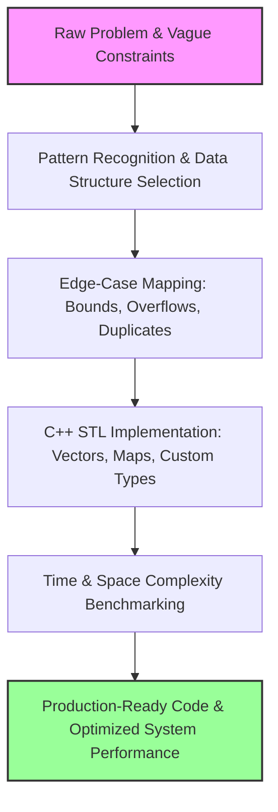
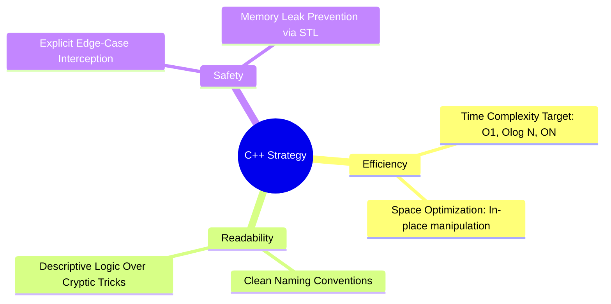

# LeetCode Solutions in [C++]

**My structured approach to solving LeetCode problems in clean, modern C++.** Each solution prioritizes peak algorithmic efficiency while maintaining highly readable and maintainable code.

This repository is more than just technical interview preparation—it is a continuous practice arena for honing the software design patterns, mental models, and performance optimizations required for everyday production software engineering.

---

## 📈 Progress

*This section updates itself: each solution starts with a one-line tag (difficulty, time, space, pattern, real-world use), and a GitHub Action rebuilds these tables on every push.*

<!-- PROGRESS:START -->
**115 problems solved** · 🟢 31 Easy · 🟡 63 Medium · 🔴 21 Hard

### By Pattern

| Pattern | Solved | Where it's used in real systems |
| :--- | :---: | :--- |
| Hash Map | 12 | O(1) lookups: dedup, grouping, counting, caching |
| Linked List | 10 | LRU caches, undo history, allocators, cycle detection |
| Dynamic Programming | 9 | Diff tools, budgeting, scheduling, trading strategies |
| Two Pointers | 7 | Dedup, in-place rotation, merging sorted data |
| Bit Manipulation | 6 | Flags, checksums, subnet math, compact storage |
| Math | 6 | Spreadsheet labels, date math, primes for hashing |
| Tree | 6 | File systems, DOM trees, ASTs, database indexes |
| Design | 5 | Caches, iterators, buffered I/O, streaming APIs |
| Graph | 5 | Routing, flood fill, object-graph copying, connected regions |
| String | 5 | Parsing, fuzzy matching, version compare, text search |
| Binary Search | 4 | Index lookups, git bisect, searching sorted or rotated data |
| Backtracking | 3 | Search over choices: segmentation, solvers, config generation |
| Stack | 3 | Expression evaluation, undo stacks, parsers |
| Trie | 3 | Autocomplete, spell check, IP routing |
| Binary Tree DFS | 2 | — |
| Greedy | 2 | Fuel/battery planning, fair allocation |
| Sliding Window | 2 | Rate limiters, stream analytics, quotas |
| Sorting | 2 | Ranking, custom ordering, gap analysis |
| Topological Sort | 2 | Build systems, package managers, task schedulers |
| 2D DP | 1 | — |
| Array | 1 | Gap detection in IDs, schedules and sequence numbers |
| BST Inorder Traversal | 1 | — |
| BST Traversal | 1 | — |
| Binary Tree + Divide and Conquer | 1 | — |
| Boyer-Moore Voting | 1 | — |
| Bucketing + Sliding Window | 1 | — |
| Design + Queue | 1 | — |
| Design + Stack | 1 | — |
| Divide and Conquer | 1 | Parallel merge sort, inversion metrics in rankings |
| Fast & Slow Pointers + Reversal | 1 | — |
| Geometry | 1 | — |
| Heap | 1 | — |
| Math / Digit Counting | 1 | — |
| Matrix | 1 | Image processing, grid-based games and spreadsheets |
| Monotonic Deque | 1 | — |
| Prefix/Suffix Products | 1 | — |
| Sliding Window + Hash Set | 1 | — |
| Stack (Simulated) | 1 | — |
| Staircase Search | 1 | — |
| Sweep Line + Multiset | 1 | — |

### All Problems

| # | Problem | Difficulty | Time | Space | Pattern | Real-world use |
| ---: | :--- | :---: | :--- | :--- | :--- | :--- |
| 1 | [Two Sum](1.%20Two%20Sum.cpp) | 🟢 Easy | O(n) | O(n) | Hash Map | Matching transaction pairs that reconcile to a target amount |
| 4 | [Median of Two Sorted Arrays](4.%20Median%20of%20Two%20Sorted%20Arrays.cpp) | 🔴 Hard | O(log(min(m,n))) | O(1) | Binary Search | Merging percentile stats from two sorted data shards |
| 26 | [Remove Duplicates from Sorted Array](26.%20Remove%20Duplicates%20from%20Sorted%20Array.cpp) | 🟢 Easy | O(n) | O(1) | Two Pointers | Deduplicating sorted log or event streams |
| 31 | [Next Permutation](31.%20Next%20Permutation.cpp) | 🟡 Medium | O(n) | O(1) | Two Pointers | Stepping through configurations in order for exhaustive testing |
| 48 | [Rotate Image](48.%20Rotate%20Image.cpp) | 🟡 Medium | O(n²) | O(1) | Matrix | Rotating images in photo editors and camera pipelines |
| 49 | [Group Anagrams](49.%20Group%20Anagrams.cpp) | 🟡 Medium | O(n·k log k) | O(n·k) | Hash Map | Grouping equivalent search queries or near-duplicate keys |
| 70 | [Climbing Stairs](70.%20Climbing%20Stairs.cpp) | 🟢 Easy | O(n) | O(1) | Dynamic Programming | Counting the ways to complete multi-step workflows |
| 124 | [Binary Tree Maximum Path Sum](124.%20Binary%20Tree%20Maximum%20Path%20Sum.cpp) | 🔴 Hard | O(n) | O(h) | Tree | Finding the most valuable path in hierarchical cost models |
| 125 | [Valid Palindrome](125.%20Valid%20Palindrome.cpp) | 🟢 Easy | O(n) | O(1) | Two Pointers | Input normalization and validation |
| 126 | [Word Ladder II](126.%20Word%20Ladder%20II.cpp) | 🔴 Hard | O(N·L·26 + paths) | O(N·L) | Graph | Listing every shortest route in navigation or network hops |
| 127 | [Word Ladder](127.%20Word%20Ladder.cpp) | 🔴 Hard | O(N·L·26) | O(N·L) | Graph | Shortest transformation chains (gene mutation, spelling fixes) |
| 128 | [Longest Consecutive Sequence](128.%20Longest%20Consecutive%20Sequence.cpp) | 🟡 Medium | O(n) | O(n) | Hash Map | Finding streaks in activity data (login days, uptime) |
| 129 | [Sum Root to Leaf Numbers](129.%20Sum%20Root%20to%20Leaf%20Numbers.cpp) | 🟡 Medium | O(n) | O(h) | Tree | Accumulating values along hierarchical paths (prefix codes) |
| 130 | [Surrounded Regions](130.%20Surrounded%20Regions.cpp) | 🟡 Medium | O(m·n) | O(m·n) | Graph | Flood fill and region capture in image editors and board games |
| 131 | [Palindrome Partitioning](131.%20Palindrome%20Partitioning.cpp) | 🟡 Medium | O(n·2ⁿ) | O(n²) | Backtracking | Enumerating every way to segment text |
| 132 | [Palindrome Partitioning II](132.%20Palindrome%20Partitioning%20II.cpp) | 🔴 Hard | O(n²) | O(n) | Dynamic Programming | Minimal segmentation in tokenizers and compressors |
| 133 | [Clone Graph](133.%20Clone%20Graph.cpp) | 🟡 Medium | O(V+E) | O(V) | Graph | Deep-copying object graphs (snapshots, serialization) |
| 134 | [Gas Station](134.%20Gas%20Station.cpp) | 🟡 Medium | O(n) | O(1) | Greedy | Route planning under fuel or battery limits |
| 135 | [Candy](135.%20Candy.cpp) | 🔴 Hard | O(n) | O(n) | Greedy | Fair reward distribution under ranking rules |
| 136 | [Single Number](136.%20Single%20Number.cpp) | 🟢 Easy | O(n) | O(1) | Bit Manipulation | Finding the unpaired item with XOR parity (error detection) |
| 137 | [Single Number II](137.%20Single%20Number%20II.cpp) | 🟡 Medium | O(n) | O(1) | Bit Manipulation | Bit-level state counters in checksums and hardware logic |
| 138 | [Copy List with Random Pointer](138.%20Copy%20List%20with%20Random%20Pointer.cpp) | 🟡 Medium | O(n) | O(1) | Linked List | Deep-copying structures that hold cross-references |
| 139 | [Word Break](139.%20Word%20Break.cpp) | 🟡 Medium | O(n·L²) | O(n) | Dynamic Programming | Word segmentation for search (hashtags, URLs, CJK text) |
| 140 | [Word Break II](140.%20Word%20Break%20II.cpp) | 🔴 Hard | O(2ⁿ) worst | O(2ⁿ) worst | Backtracking | Generating every segmentation for spelling suggestions |
| 141 | [Linked List Cycle](141.%20Linked%20List%20Cycle.cpp) | 🟢 Easy | O(n) | O(1) | Linked List | Detecting infinite loops in pointer structures |
| 142 | [Linked List Cycle II](142.%20Linked%20List%20Cycle%20II.cpp) | 🟡 Medium | O(n) | O(1) | Linked List | Finding where a loop starts when debugging cycles |
| 143 | [Reorder List](143.%20Reorder%20List.cpp) | 🟡 Medium | O(n) | O(1) | Linked List | In-place reordering of buffers and playlists |
| 144 | [Binary Tree Preorder Traversal](144.%20Binary%20Tree%20Preorder%20Traversal.cpp) | 🟢 Easy | O(n) | O(h) | Tree | Serializing trees (DOM, file systems) |
| 145 | [Binary Tree Postorder Traversal](145.%20Binary%20Tree%20Postorder%20Traversal.cpp) | 🟢 Easy | O(n) | O(h) | Tree | Bottom-up work like deleting folders or summing their sizes |
| 146 | [LRU Cache](146.%20LRU%20Cache.cpp) | 🟡 Medium | O(1) per op | O(capacity) | Design | Caches in CDNs, databases and browsers |
| 147 | [Insertion Sort List](147.%20Insertion%20Sort%20List.cpp) | 🟡 Medium | O(n²) | O(1) | Linked List | Keeping small, nearly sorted lists in order as items arrive |
| 148 | [Sort List](148.%20Sort%20List.cpp) | 🟡 Medium | O(n log n) | O(log n) | Linked List | Merge sort on linked data (external sorting) |
| 149 | [Max Points on a Line](149.%20Max%20Points%20on%20a%20Line.cpp) | 🔴 Hard | O(n² log n) | O(n) | Hash Map | Line detection in computer vision and GIS data |
| 150 | [Evaluate Reverse Polish Notation](150.%20Evaluate%20Reverse%20Polish%20Notation.cpp) | 🟡 Medium | O(n) | O(n) | Stack | Expression evaluation in calculators, compilers and VMs |
| 151 | [Reverse Words in a String](151.%20Reverse%20Words%20in%20a%20String.cpp) | 🟡 Medium | O(n) | O(n) | String | Text cleanup and tokenization |
| 152 | [Maximum Product Subarray](152.%20Maximum%20Product%20Subarray.cpp) | 🟡 Medium | O(n) | O(1) | Dynamic Programming | Best compounding period in growth-rate data |
| 153 | [Find Minimum in Rotated Sorted Array](153.%20Find%20Minimum%20in%20Rotated%20Sorted%20Array.cpp) | 🟡 Medium | O(log n) | O(1) | Binary Search | Searching rotated logs and ring buffers |
| 154 | [Find Minimum in Rotated Sorted Array II](154.%20Find%20Minimum%20in%20Rotated%20Sorted%20Array%20II.cpp) | 🔴 Hard | O(log n) avg, O(n) worst | O(1) | Binary Search | Searching rotated data that contains duplicates |
| 155 | [Min Stack](155.%20Min%20Stack.cpp) | 🟡 Medium | O(1) per op | O(n) | Stack | Undo stacks that track a running minimum |
| 156 | [Binary Tree Upside Down](156.%20Binary%20Tree%20Upside%20Down.cpp) | 🟡 Medium | O(n) | O(1) | Tree | Restructuring hierarchies in place |
| 157 | [Read N Characters Given Read4](157.%20Read%20N%20Characters%20Given%20Read4.cpp) | 🟢 Easy | O(n) | O(1) | Design | Reading files through fixed-size block APIs |
| 158 | [Read N Characters Given read4 II - Call Multiple Times](158.%20Read%20N%20Characters%20Given%20read4%20II%20-%20Call%20Multiple%20Times.cpp) | 🔴 Hard | O(n) | O(1) | Design | Stateful buffered readers for streams and sockets |
| 159 | [Longest Substring with At Most Two Distinct Characters](159.%20Longest%20Substring%20with%20At%20Most%20Two%20Distinct%20Characters.cpp) | 🟡 Medium | O(n) | O(1) | Sliding Window | Stream analytics limited to a few distinct values |
| 160 | [Intersection of Two Linked Lists](160.%20Intersection%20of%20Two%20Linked%20Lists.cpp) | 🟢 Easy | O(m+n) | O(1) | Linked List | Finding a shared ancestor (like a git merge base) |
| 161 | [One Edit Distance](161.%20One%20Edit%20Distance.cpp) | 🟡 Medium | O(n) | O(1) | String | Typo detection and fuzzy matching |
| 162 | [Find Peak Element](162.%20Find%20Peak%20Element.cpp) | 🟡 Medium | O(log n) | O(1) | Binary Search | Finding local peaks in signals and metrics |
| 163 | [Missing Ranges](163.%20Missing%20Ranges.cpp) | 🟢 Easy | O(n) | O(1) | Array | Finding gaps in IDs, sequence numbers or schedules |
| 164 | [Maximum Gap](164.%20Maximum%20Gap.cpp) | 🟡 Medium | O(n) | O(n) | Sorting | Spotting the largest gap in time-series data |
| 165 | [Compare Version Numbers](165.%20Compare%20Version%20Numbers.cpp) | 🟡 Medium | O(n+m) | O(1) | String | Comparing software versions in package managers |
| 166 | [Fraction to Recurring Decimal](166.%20Fraction%20to%20Recurring%20Decimal.cpp) | 🟡 Medium | O(d) | O(d) | Hash Map | Exact decimal display in calculators and finance apps |
| 167 | [Two Sum II - Input Array Is Sorted](167.%20Two%20Sum%20II%20-%20Input%20Array%20Is%20Sorted.cpp) | 🟡 Medium | O(n) | O(1) | Two Pointers | Pair matching on sorted data (budget pairing) |
| 168 | [Excel Sheet Column Title](168.%20Excel%20Sheet%20Column%20Title.cpp) | 🟢 Easy | O(log n) | O(1) | Math | Spreadsheet column labels |
| 169 | [Majority Element](169.%20Majority%20Element.cpp) | 🟢 Easy | O(n) | O(n) | Hash Map | Majority voting in distributed consensus |
| 170 | [Two Sum III - Data structure design](170.%20Two%20Sum%20III%20-%20Data%20structure%20design.cpp) | 🟢 Easy | O(1) add, O(n) find | O(n) | Design | Real-time pair-sum queries on streaming data |
| 171 | [Excel Sheet Column Number](171.%20Excel%20Sheet%20Column%20Number.cpp) | 🟢 Easy | O(n) | O(1) | Math | Parsing spreadsheet column labels |
| 172 | [Factorial Trailing Zeroes](172.%20Factorial%20Trailing%20Zeroes.cpp) | 🟡 Medium | O(log n) | O(1) | Math | Number theory in big-number libraries |
| 173 | [Binary Search Tree Iterator](173.%20Binary%20Search%20Tree%20Iterator.cpp) | 🟡 Medium | O(1) avg | O(h) | Design | Lazy iterators and database cursors over sorted indexes |
| 174 | [Dungeon Game](174.%20Dungeon%20Game.cpp) | 🔴 Hard | O(m·n) | O(n) | Dynamic Programming | Resource budgeting along grid paths (robotics, games) |
| 179 | [Largest Number](179.%20Largest%20Number.cpp) | 🟡 Medium | O(n log n) | O(n) | Sorting | Ordering items with a custom comparator |
| 186 | [Reverse Words in a String II](186.%20Reverse%20Words%20in%20a%20String%20II.cpp) | 🟡 Medium | O(n) | O(1) | Two Pointers | In-place text edits on memory-limited systems |
| 187 | [Repeated DNA Sequences](187.%20Repeated%20DNA%20Sequences.cpp) | 🟡 Medium | O(n) | O(n) | Hash Map | Rolling hashes for genome analysis and plagiarism checks |
| 188 | [Best Time to Buy and Sell Stock IV](188.%20Best%20Time%20to%20Buy%20and%20Sell%20Stock%20IV.cpp) | 🔴 Hard | O(n·k) | O(k) | Dynamic Programming | Trading strategies with a transaction limit |
| 189 | [Rotate Array](189.%20Rotate%20Array.cpp) | 🟡 Medium | O(n) | O(1) | Two Pointers | Rotating circular buffers |
| 190 | [Reverse Bits](190.%20Reverse%20Bits.cpp) | 🟢 Easy | O(1) | O(1) | Bit Manipulation | Bit reversal in FFT and signal processing |
| 191 | [Number of 1 Bits](191.%20Number%20of%201%20Bits.cpp) | 🟢 Easy | O(1) | O(1) | Bit Manipulation | Counting set flags in permissions and bitmap indexes |
| 198 | [House Robber](198.%20House%20Robber.cpp) | 🟡 Medium | O(n) | O(1) | Dynamic Programming | Picking non-conflicting jobs or ads for maximum value |
| 199 | [Binary Tree Right Side View](199.%20Binary%20Tree%20Right%20Side%20View.cpp) | 🟡 Medium | O(n) | O(w) | Tree | Finding visible elements in UI hierarchies |
| 200 | [Number of Islands](200.%20Number%20of%20Islands.cpp) | 🟡 Medium | O(m·n) | O(min(m,n)) | Graph | Counting connected regions in maps and images |
| 201 | [Bitwise AND of Numbers Range](201.%20Bitwise%20AND%20of%20Numbers%20Range.cpp) | 🟡 Medium | O(log n) | O(1) | Bit Manipulation | Subnet and CIDR prefix calculation |
| 202 | [Happy Number](202.%20Happy%20Number.cpp) | 🟢 Easy | O(log n) | O(1) | Math | Cycle detection in iterated functions |
| 203 | [Remove Linked List Elements](203.%20Remove%20Linked%20List%20Elements.cpp) | 🟢 Easy | O(n) | O(1) | Linked List | Filtering records out of linked structures |
| 204 | [Count Primes](204.%20Count%20Primes.cpp) | 🟡 Medium | O(n log log n) | O(n) | Math | Generating primes for hashing and cryptography |
| 205 | [Isomorphic Strings](205.%20Isomorphic%20Strings.cpp) | 🟢 Easy | O(n) | O(1) | Hash Map | Checking one-to-one mappings (ciphers, schema mapping) |
| 206 | [Reverse Linked List](206.%20Reverse%20Linked%20List.cpp) | 🟢 Easy | O(n) | O(1) | Linked List | Reversing history for undo/redo |
| 207 | [Course Schedule](207.%20Course%20Schedule.cpp) | 🟡 Medium | O(V+E) | O(V+E) | Topological Sort | Detecting dependency cycles in build tools and package managers |
| 208 | [Implement Trie (Prefix Tree)](208.%20Implement%20Trie%20%28Prefix%20Tree%29.cpp) | 🟡 Medium | O(L) per op | O(total chars) | Trie | Autocomplete and IP routing tables |
| 209 | [Minimum Size Subarray Sum](209.%20Minimum%20Size%20Subarray%20Sum.cpp) | 🟡 Medium | O(n) | O(1) | Sliding Window | Shortest window that meets a quota (rate limits, SLAs) |
| 210 | [Course Schedule II](210.%20Course%20Schedule%20II.cpp) | 🟡 Medium | O(V+E) | O(V+E) | Topological Sort | Ordering tasks in schedulers (Airflow, make) |
| 211 | [Design Add and Search Words Data Structure](211.%20Design%20Add%20and%20Search%20Words%20Data%20Structure.cpp) | 🟡 Medium | O(L) add, O(26ᵈ·L) search | O(total chars) | Trie | Wildcard dictionary search |
| 212 | [Word Search II](212.%20Word%20Search%20II.cpp) | 🔴 Hard | O(m·n·4ᴸ) | O(total chars) | Trie | Word games and multi-pattern grid search |
| 213 | [House Robber II](213.%20House%20Robber%20II.cpp) | 🟡 Medium | O(n) | O(1) | Dynamic Programming | Scheduling on circular timetables |
| 214 | [Shortest Palindrome](214.%20Shortest%20Palindrome.cpp) | 🔴 Hard | O(n) | O(n) | String | KMP pattern matching in editors and DNA search |
| 215 | [Kth Largest Element in an Array](215.%20Kth%20Largest%20Element%20in%20an%20Array.cpp) | 🟡 Medium | O(n log k) | O(k) | Heap | Top-K leaderboards and streaming rank queries |
| 216 | [Combination Sum III](216.%20Combination%20Sum%20III.cpp) | 🟡 Medium | O(C(9,k) * k) | O(k) | Backtracking | Enumerating constrained subsets in puzzles (e.g. Kakuro) |
| 217 | [Contains Duplicate](217.%20Contains%20Duplicate.cpp) | 🟢 Easy | O(n) | O(n) | Hash Map | Duplicate detection in uploads and sign-ups |
| 218 | [The Skyline Problem](218.%20The%20Skyline%20Problem.cpp) | 🔴 Hard | O(n log n) | O(n) | Sweep Line + Multiset | Rendering silhouettes and interval union heights |
| 219 | [Contains Duplicate II](219.%20Contains%20Duplicate%20II.cpp) | 🟢 Easy | O(n) | O(k) | Sliding Window + Hash Set | Detecting repeated events within a time window |
| 220 | [Contains Duplicate III](220.%20Contains%20Duplicate%20III.cpp) | 🔴 Hard | O(n) | O(k) | Bucketing + Sliding Window | Near-duplicate detection in sensor/price streams |
| 221 | [Maximal Square](221.%20Maximal%20Square.cpp) | 🟡 Medium | O(m*n) | O(n) | 2D DP | Finding largest free square region in image/grid maps |
| 222 | [Count Complete Tree Nodes](222.%20Count%20Complete%20Tree%20Nodes.cpp) | 🟢 Easy | O(log^2 n) | O(log n) | Binary Tree + Divide and Conquer | Sizing heap-shaped trees without full traversal |
| 223 | [Rectangle Area](223.%20Rectangle%20Area.cpp) | 🟡 Medium | O(1) | O(1) | Geometry | Bounding-box overlap in collision detection and UI layout |
| 224 | [Basic Calculator](224.%20Basic%20Calculator.cpp) | 🔴 Hard | O(n) | O(n) | Stack | Expression evaluation in calculators and interpreters |
| 225 | [Implement Stack using Queues](225.%20Implement%20Stack%20using%20Queues.cpp) | 🟢 Easy | O(n) push, O(1) others | O(n) | Design + Queue | Adapting data structure interfaces |
| 226 | [Invert Binary Tree](226.%20Invert%20Binary%20Tree.cpp) | 🟢 Easy | O(n) | O(h) | Binary Tree DFS | Mirroring hierarchical layouts (e.g. RTL UI trees) |
| 227 | [Basic Calculator II](227.%20Basic%20Calculator%20II.cpp) | 🟡 Medium | O(n) | O(1) | Stack (Simulated) | Operator-precedence parsing in expression engines |
| 228 | [Summary Ranges](228.%20Summary%20Ranges.cpp) | 🟢 Easy | O(n) | O(1) | Two Pointers | Compressing ID lists (e.g. "pages 1-5, 8") |
| 229 | [Majority Element II](229.%20Majority%20Element%20II.cpp) | 🟡 Medium | O(n) | O(1) | Boyer-Moore Voting | Finding heavy hitters in data streams |
| 230 | [Kth Smallest Element in a BST](230.%20Kth%20Smallest%20Element%20in%20a%20BST.cpp) | 🟡 Medium | O(h + k) | O(h) | BST Inorder Traversal | Order-statistic queries on sorted indexes |
| 231 | [Power of Two](231.%20Power%20of%20Two.cpp) | 🟢 Easy | O(1) | O(1) | Bit Manipulation | Validating buffer/allocation sizes |
| 232 | [Implement Queue using Stacks](232.%20Implement%20Queue%20using%20Stacks.cpp) | 🟢 Easy | O(1) amortized | O(n) | Design + Stack | Building FIFO buffers from LIFO primitives |
| 233 | [Number of Digit One](233.%20Number%20of%20Digit%20One.cpp) | 🔴 Hard | O(log n) | O(1) | Math / Digit Counting | Digit frequency analysis (e.g. Benford checks) |
| 234 | [Palindrome Linked List](234.%20Palindrome%20Linked%20List.cpp) | 🟢 Easy | O(n) | O(1) | Fast & Slow Pointers + Reversal | Symmetric sequence checks on streams |
| 235 | [Lowest Common Ancestor of a Binary Search Tree](235.%20Lowest%20Common%20Ancestor%20of%20a%20Binary%20Search%20Tree.cpp) | 🟡 Medium | O(h) | O(1) | BST Traversal | Finding shared ancestors in ordered hierarchies |
| 236 | [Lowest Common Ancestor of a Binary Tree](236.%20Lowest%20Common%20Ancestor%20of%20a%20Binary%20Tree.cpp) | 🟡 Medium | O(n) | O(h) | Binary Tree DFS | Merge-base lookup in version control and org charts |
| 237 | [Delete Node in a Linked List](237.%20Delete%20Node%20in%20a%20Linked%20List.cpp) | 🟡 Medium | O(1) | O(1) | Linked List | In-place removal when only a node handle is available |
| 238 | [Product of Array Except Self](238.%20Product%20of%20Array%20Except%20Self.cpp) | 🟡 Medium | O(n) | O(1) extra | Prefix/Suffix Products | Leave-one-out aggregates in analytics |
| 239 | [Sliding Window Maximum](239.%20Sliding%20Window%20Maximum.cpp) | 🔴 Hard | O(n) | O(k) | Monotonic Deque | Rolling max for stock prices and network monitoring |
| 240 | [Search a 2D Matrix II](240.%20Search%20a%202D%20Matrix%20II.cpp) | 🟡 Medium | O(m + n) | O(1) | Staircase Search | Lookups in row/column-sorted tables |
| 493 | [Reverse Pairs](493.%20Reverse%20Pairs.cpp) | 🔴 Hard | O(n log n) | O(n) | Divide and Conquer | Counting ranking inversions in recommendation systems |
| 554 | [Brick Wall](554.%20Brick%20Wall.cpp) | 🟡 Medium | O(total bricks) | O(n) | Hash Map | Finding the best cut line (layout, shard boundaries) |
| 2131 | [Longest Palindrome by Concatenating Two Letter Words](2131.%20Longest%20Palindrome%20by%20Concatenating%20Two%20Letter%20Words.cpp) | 🟡 Medium | O(n) | O(1) | Hash Map | Pairing complementary items, like matching buy and sell orders |
| 2225 | [Find Players With Zero or One Losses](2225.%20Find%20Players%20With%20Zero%20or%20One%20Losses.cpp) | 🟡 Medium | O(n log n) | O(n) | Hash Map | Tournament standings and leaderboards |
| 2409 | [Count Days Spent Together](2409.%20Count%20Days%20Spent%20Together.cpp) | 🟢 Easy | O(1) | O(1) | Math | Date-range overlap in booking systems |
| 3503 | [Longest Palindrome After Substring Concatenation I](3503.%20Longest%20Palindrome%20After%20Substring%20Concatenation%20I.cpp) | 🟡 Medium | O(n²·m²·(n+m)) | O(n+m) | String | Palindrome checks across combined inputs (brute force) |
| 3505 | [Minimum Operations to Make Elements Within K Subarrays Equal](3505.%20Minimum%20Operations%20to%20Make%20Elements%20Within%20K%20Subarrays%20Equal.cpp) | 🔴 Hard | O(n log x + n·k) | O(n) | Dynamic Programming | Minimizing adjustment cost across batch segments |
<!-- PROGRESS:END -->

---

## The Engineering Workflow Blueprint

The lifecycle of solving these architectural challenges builds skills that translate directly into scalable production code:



---

## Mapping Theoretical Patterns to Real-World Architecture

| **Pattern** | **Production Systems Application** |
| :--- | :--- |
| 🗂️ **Hash Maps & Sets** | Low-latency caching tiers, deduplicating high-throughput data streams, O(1) event logging analysis, real-time dataset joins. |
| 🔄 **Two Pointers & Sliding Window** | Log-stream log aggregators, sliding-window rate limiters, token bucket algorithms, text parsing, two-way sorted data merges. |
| 📊 **Sorting & Merging** | Search engine result ranking, multi-source distributed data alignment, event schedulers, indexing engines. |
| 🔍 **Binary Search** | High-performance search engines operating on immutable files, automated regression tracking (`git bisect`), distributed system parameter tuning. |
| 🔗 **Linked Lists** | Under-the-hood LRU/LFU caching layers, transactional undo/redo pipelines, low-level custom memory allocators, OS kernel process queues. |
| 🌳 **Trees & Recursion** | Hierarchical file systems, HTML DOM tree construction, JSON/XML abstract syntax trees, compiler building blocks, B+ tree database indices. |
| 📐 **Dynamic Programming** | Text delta determination tools (`diff`), spell-checking dictionary software, delivery route planning optimization, cloud resource budgeting algorithms. |
| 🔲 **Matrix Manipulation** | Computer vision pipelines (rotations, kernels), interactive game boards, grid-based spreadsheet engine cells, 2D graphics rendering. |
| 🪓 **Divide and Conquer** | Distributed merge sort, parallel multi-threaded computing, statistical recommendation engine ranking inversion metrics. |
| 📅 **Date & Interval Logic** | Multi-tenant booking systems, calendar overlap algorithms, resource allocation scheduling software. |

---

## Core Engineering Benefits

### 🚀 Writing Scalable, Cost-Efficient Code
Differentiating between $O(N^2)$ and $O(N \log N)$ complexity means the difference between a service that collapses under a production spike and one that runs smoothly. Optimal complexity reduces CPU cycles, slashes cloud compute infrastructure bills, and ensures sub-second user response times.

### 🧠 Automatic Data Structure Selection
Suboptimal data structure choice (like scanning a sequential array when a hash set or tree is required) creates massive performance bottlenecks. Continuous algorithmic practice turns structural decisions into an intuitive reflex.

### 🛡️ Defending Against Edge Cases
LeetCode’s strict test suites enforce rigorous engineering discipline. Anticipating null pointers, memory boundary overflows, type wrapping, and extreme values carries directly into writing robust, self-defending production software.

### 🧩 System Deconstruction
Breaking abstract, ambiguous puzzles into atomic, reproducible steps forms the exact foundation needed for scalable system design, complex root-cause debugging, and macro feature planning.

### 🏎️ Mastering Modern C++
Every solution refines fluency within the C++ Standard Template Library (`std::vector`, `std::unordered_map`, `std::priority_queue`, algorithms). This practice enforces explicit control over memory layouts, pointer management, and modern language paradigms.

---

## Repository Philosophy & Approach

*   **Language Standard:** Clean, idiomatic **C++** utilizing modern conventions.
*   **Goal:** Best-in-class time and space complexity targeting the absolute theoretical limits of the problem.
*   **Readability:** Clear variable naming, self-documenting logic, and thoughtful commenting—written for humans, not just compilers.



---
*Updating regularly. To add a problem: create `N. Title.cpp` with the tag line on top, then push.*

```cpp
// Difficulty: Medium | Time: O(n) | Space: O(1) | Pattern: Hash Map | Use: Where it shows up in real systems
```
