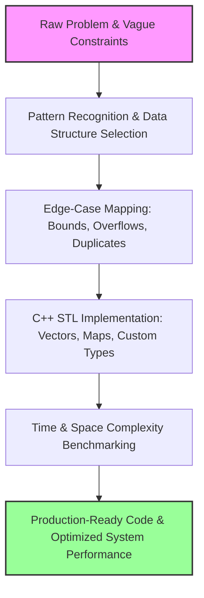
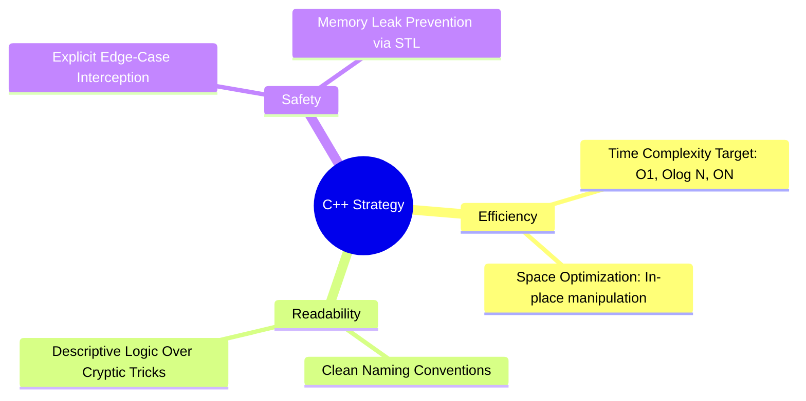

# LeetCode Solutions in [C++]

**My structured approach to solving LeetCode problems in clean, modern C++.** Each solution prioritizes peak algorithmic efficiency while maintaining highly readable and maintainable code.

This repository is more than just technical interview preparation—it is a continuous practice arena for honing the software design patterns, mental models, and performance optimizations required for everyday production software engineering.

---

## The Engineering Workflow Blueprint

The lifecycle of solving these architectural challenges builds skills that translate directly into scalable production code:

---

## Mapping Theoretical Patterns to Real-World Architecture

| **Pattern** | **Production Systems Application** |
| :--- | :--- |
| 🗂️ **Hash Maps & Sets** | Low-latency caching tiers, deduplicating high-throughput data streams, O(1) event logging analysis, real-time dataset joins. |
| 🔄 **Two Pointers & Sliding Window** | Log-stream log aggregators, sliding-window rate limiters, token bucket algorithms, text parsing, two-way sorted data merges. |
| 📊 **Sorting & Merging** | Search engine result ranking, multi-source distributed data alignment, event schedulers, indexing engines. |
| 🔍 **Binary Search** | High-performance search engines operating on immutable files, automated regression tracking (`git bisect`), distributed system parameter tuning. |
| 🔗 **Linked Lists** | Under-the-hood LRU/LFU caching layers, transactional undo/redo pipelines, low-level custom memory allocators, OS kernel process queues. |
| 🌳 **Trees & Recursion** | Hierarchical file systems, HTML DOM tree construction, JSON/XML abstract syntax trees, compiler building blocks, B+ tree database indices. |
| 📐 **Dynamic Programming** | Text delta determination tools (`diff`), spell-checking dictionary software, delivery route planning optimization, cloud resource budgeting algorithms. |
| 🔲 **Matrix Manipulation** | Computer vision pipelines (rotations, kernels), interactive game boards, grid-based spreadsheet engine cells, 2D graphics rendering. |
| 🪓 **Divide and Conquer** | Distributed merge sort, parallel multi-threaded computing, statistical recommendation engine ranking inversion metrics. |
| 📅 **Date & Interval Logic** | Multi-tenant booking systems, calendar overlap algorithms, resource allocation scheduling software. |

---

## Core Engineering Benefits

### 🚀 Writing Scalable, Cost-Efficient Code
Differentiating between $O(N^2)$ and $O(N \log N)$ complexity means the difference between a service that collapses under a production spike and one that runs smoothly. Optimal complexity reduces CPU cycles, slashes cloud compute infrastructure bills, and ensures sub-second user response times.

### 🧠 Automatic Data Structure Selection
Suboptimal data structure choice (like scanning a sequential array when a hash set or tree is required) creates massive performance bottlenecks. Continuous algorithmic practice turns structural decisions into an intuitive reflex.

### 🛡️ Defending Against Edge Cases
LeetCode’s strict test suites enforce rigorous engineering discipline. Anticipating null pointers, memory boundary overflows, type wrapping, and extreme values carries directly into writing robust, self-defending production software.

### 🧩 System Deconstruction
Breaking abstract, ambiguous puzzles into atomic, reproducible steps forms the exact foundation needed for scalable system design, complex root-cause debugging, and macro feature planning.

### 🏎️ Mastering Modern C++
Every solution refines fluency within the C++ Standard Template Library (`std::vector`, `std::unordered_map`, `std::priority_queue`, algorithms). This practice enforces explicit control over memory layouts, pointer management, and modern language paradigms.

---

## Repository Philosophy & Approach

*   **Language Standard:** Clean, idiomatic **C++** utilizing modern conventions.
*   **Goal:** Best-in-class time and space complexity targeting the absolute theoretical limits of the problem.
*   **Readability:** Clear variable naming, self-documenting logic, and thoughtful commenting—written for humans, not just compilers.

---
*Updating regularly.*
